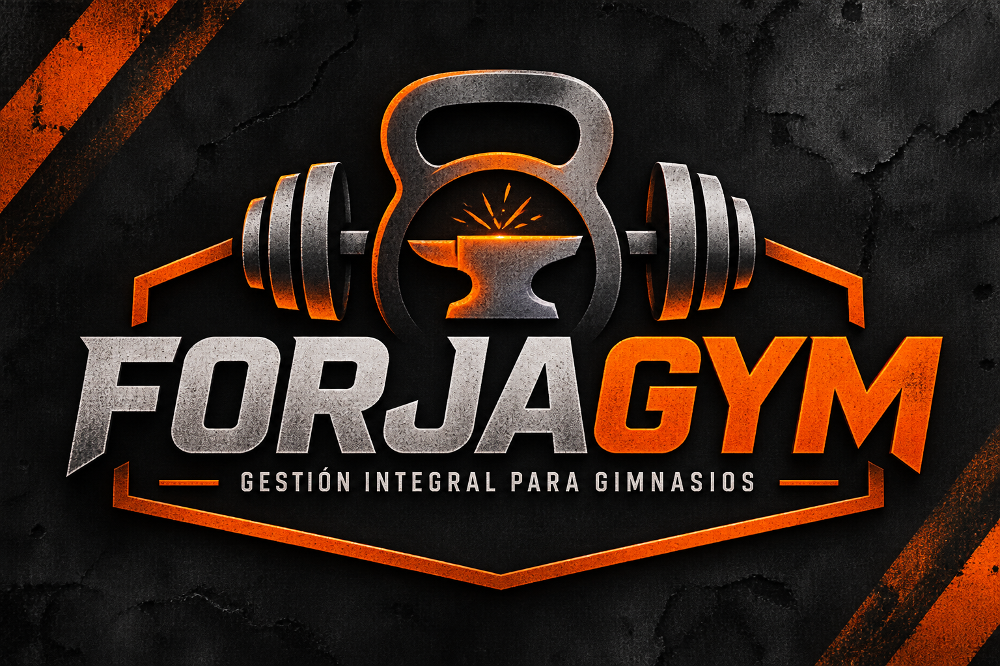

# FORJAGYM

**Sistema de gestión local para gimnasios pequeños y entrenadores independientes.**

FORJAGYM es una aplicación de escritorio desarrollada en Python para organizar socios, cuotas, asistencias y rutinas de entrenamiento desde una computadora con Windows. Está pensada como una alternativa sencilla, local y sin suscripciones para gimnasios que necesitan ordenar su operación diaria.

> **Importante:** esta publicación contiene código fuente y recursos de la aplicación. No incluye bases de datos reales ni información de clientes. Cada instalación crea y utiliza su propia base de datos local.

## Características principales

### ADMIN
- Alta, consulta, edición y administración de socios.
- Registro y consulta de pagos y cuotas.
- Administración de planes y precios.
- Consulta de asistencias e historial de fichajes.
- Panel de estadísticas y reportes.
- Creación y administración de rutinas maestras.
- Asignación de rutinas individuales a socios e historial de asignaciones.
- Visualización interna de rutinas por día y semana.
- Exportación de rutinas a PDF con diseño pensado para una lectura cómoda en celulares.
- Exportación de reportes a PDF y Excel.

### FICHAJE
- Aplicación independiente para registrar ingresos.
- Identificación del socio mediante DNI.
- Validación de las reglas de asistencia configuradas por el sistema.
- Comparte la misma base SQLite local que ADMIN cuando ambos ejecutables se encuentran instalados en la misma carpeta.

### Datos locales
- SQLite como base de datos.
- No requiere un servidor ni una cuenta en la nube para el funcionamiento local.
- La base se crea en `datos/forjagym.db` al iniciar la aplicación por primera vez.

## Identidad visual



## Capturas

Podés agregar capturas propias de la aplicación en una carpeta `docs/` y enlazarlas desde esta sección. Antes de publicarlas, ocultá nombres, DNI, teléfonos, importes privados y cualquier otro dato real.

## Tecnologías

- **Python** — lógica de la aplicación.
- **CustomTkinter / Tkinter** — interfaz gráfica de escritorio.
- **SQLite** — almacenamiento local.
- **Pillow** — recursos gráficos e imágenes.
- **ReportLab** — generación de PDF.
- **OpenPyXL** — exportación a Excel.
- **PyInstaller** — generación de ejecutables para Windows.

## Requisitos

- Windows 10 u 11.
- Python 3.11 o una versión compatible posterior.
- Tkinter instalado con Python (en Windows suele incluirse en el instalador oficial).
- Git es necesario únicamente si querés clonar o publicar el repositorio desde la terminal.

## Instalación desde cero

### 1. Descargar el proyecto

Cloná el repositorio:

```powershell
git clone https://github.com/USUARIO/ForjaGym.git
cd ForjaGym
```

Reemplazá `USUARIO` por el nombre de tu cuenta de GitHub y ajustá el nombre del repositorio si elegiste otro.

También podés descargar el proyecto como ZIP desde GitHub y descomprimirlo.

### 2. Crear un entorno virtual

```powershell
python -m venv .venv
```

Activarlo en PowerShell:

```powershell
.\.venv\Scripts\Activate.ps1
```

Si PowerShell bloquea la activación, podés ejecutar el comando siguiente solo para esa terminal y volver a activar el entorno:

```powershell
Set-ExecutionPolicy -Scope Process -ExecutionPolicy Bypass
.\.venv\Scripts\Activate.ps1
```

### 3. Instalar dependencias

```powershell
python -m pip install --upgrade pip
python -m pip install -r requirements.txt
```

### 4. Ejecutar ADMIN

```powershell
python main.py
```

### 5. Ejecutar FICHAJE

Abrí otra terminal en la misma carpeta, activá también el entorno virtual e iniciá:

```powershell
python fichaje_main.py
```

ADMIN y FICHAJE utilizan la misma base de datos local. Para que compartan los registros, ejecutalos desde la misma copia del proyecto y no muevas ni dupliques la carpeta `datos` mientras estén en uso.

## Primera ejecución y base de datos

Al iniciar, el sistema crea automáticamente la carpeta `datos` y la base `forjagym.db` si todavía no existen.

Cada gimnasio debe utilizar su propia base de datos. **No compartas una base con datos reales de socios** ni la subas al repositorio.

Para realizar copias de seguridad, cerrá ADMIN y FICHAJE y copiá la carpeta `datos` a un lugar seguro. No publiques esas copias.

## Compilar ejecutables para Windows

Con Python y las dependencias instaladas, cerrá ADMIN y FICHAJE y ejecutá:

```powershell
.\COMPILAR_WINDOWS_ICONO.bat
```

El proceso utiliza PyInstaller y genera:

- `dist/ADMIN.exe`
- `dist/FICHAJE.exe`
- `dist/datos/` con la base de datos local disponible al momento de compilar.

**Antes de distribuir los ejecutables:** revisá qué base se está copiando a `dist/datos`. No entregues ni publiques una base que contenga datos reales. Para una distribución limpia, compilá con una base nueva de demostración o sin datos reales y verificá el contenido de `dist` antes de compartirlo.

Mantené ambos ejecutables y la carpeta `datos` juntos para que compartan la misma base.

## Seguridad y privacidad

- La aplicación está diseñada para trabajar con una base SQLite local.
- Publicar el código fuente en GitHub no le da a nadie acceso remoto a tu computadora ni a la PC donde se ejecute el programa.
- No incluyas bases de datos, exportaciones, copias de seguridad, credenciales ni información personal.
- Protegé el equipo con una cuenta de Windows y contraseña, actualizaciones y copias de seguridad.
- Si vas a usar el programa con información real, cada gimnasio debe proteger el acceso físico y lógico a su computadora y a sus archivos.
- Este proyecto no debe considerarse un servicio en la nube ni un sistema de almacenamiento remoto.

## Limitaciones y estado

Este proyecto se publica como herramienta comunitaria y referencia para aprender, adaptar y mejorar la gestión de un gimnasio pequeño. Probalo en un entorno de prueba antes de utilizarlo con información real.

La compatibilidad y el comportamiento pueden variar según la versión de Windows, Python y las dependencias instaladas.

## Contribuciones

Las sugerencias, reportes de errores y mejoras son bienvenidos. Antes de abrir una incidencia, evitá adjuntar bases de datos, capturas con datos personales o archivos que contengan información de socios.

## Licencia

**Licencia pendiente de elección.** Hasta que se agregue un archivo `LICENSE`, no debe asumirse que el código puede reutilizarse, modificarse o redistribuirse legalmente. Para un proyecto que querés compartir de forma amplia y permitir que otros lo adapten, una opción sencilla es la licencia MIT, siempre que tengas los derechos necesarios sobre todo el código y los recursos publicados.
